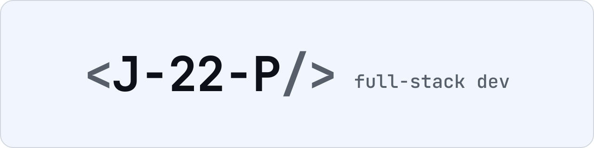

  

# Hi, I'm Pongsathorn

Full-stack developer , working mostly with TypeScript, React/Next.js and Node.js.

I build web applications end to end: user interfaces, APIs, databases, authentication, background jobs, testing and deployment. I like practical products that people use every day, from personal productivity tools to business systems for companies.

## Projects I've worked on

**[NOSION](https://github.com/J-22-P/nosion)** (personal project, built solo)  
A productivity web app that brings tasks, personal finance and habits into one place. I designed and developed the whole system myself, from the frontend and API to the database, notifications, CI/CD and deployment. [Live demo](https://nosion-staging-web.vercel.app/login)

**EzySuite** (company project, full-stack developer in a team, since Apr 2026)  
A suite of web applications that helps importers, exporters and customs brokers prepare, check and submit customs declarations. The system is split into Next.js frontends and Express (TypeScript) backend services.

- Rebuilt duty and tax calculation as a single backend flow, replacing logic duplicated across frontend screens, so every screen and saved declaration uses the same figures; results are saved in one database transaction
- Extended the calculation rules for specific-rate, anti-dumping and safeguard duties, excise, VAT and rounding, with automatic recalculation when items change
- Implemented declaration features end to end: duty-compensation forms, short-shipment handling, cost and weight distribution, and XML generation for electronic customs submission
- Prevented the same declaration from being submitted twice from two devices by checking the document version and locking it during submission
- Built an Open API that lets external systems add customer products, with request logging
- Built batch printing of official customs forms, Excel import, invoice search, and master-data screens and APIs for products, BOI certificates and customer profiles
- Added a version endpoint to every service with an in-app version popup, and updated the shared Jenkins and Docker release pipeline

**HR system and ERP reports** (internship, web application developer, Nov 2025 – Mar 2026)  
Internal systems for a company's HR and ERP users, built as part of a small development team.

- Developed HR web app screens on both the frontend (Angular) and the backend (Quarkus, Java) with Microsoft SQL Server: search and list pages, create and edit dialogs, employee history records, and document review with file download
- Migrated ERP reports from i-net Clear Reports to JasperReports (Jaspersoft Studio), an open-source tool, to cut licence costs: rebuilt the SQL queries, expressions and layouts, with export to PDF, DOCX, CSV and XLSX
- Worked from program and business specifications, with Git (GitLab) for version control

**Earlier projects:** an [environmental risk dashboard](https://github.com/J-22-P/Environmental_Rick_Project) that compares ML models for drought and flood prediction, and [READ A ROAD](https://github.com/J-22-P/Web-Novel---Read-A-Road), an online novel platform for readers, writers and admins.

## Tech stack

  
   
  

**Languages:** TypeScript, JavaScript, Java, SQL, HTML, CSS

**Frontend:** React, Next.js, Angular, Tailwind CSS, Ant Design, styled-components, TanStack Query, Zustand, React Hook Form, Zod

**Backend:** Node.js, NestJS, Express, Quarkus, REST APIs, Swagger/OpenAPI, Socket.IO, BullMQ

**Database:** PostgreSQL, Microsoft SQL Server, Prisma, Redis, SQLite

**Auth:** JWT, OAuth 2.0, Argon2id, bcrypt

**Testing:** Vitest, Playwright, Supertest

**DevOps & tools:** Docker, Jenkins, GitHub Actions, GitLab, Vercel, Supabase, Turborepo, pnpm, Git, JasperReports

## GitHub stats

  

## Contact

[Email](mailto:pongsathorn.junt@gmail.com) : pongsathorn.junt@gmail.com
